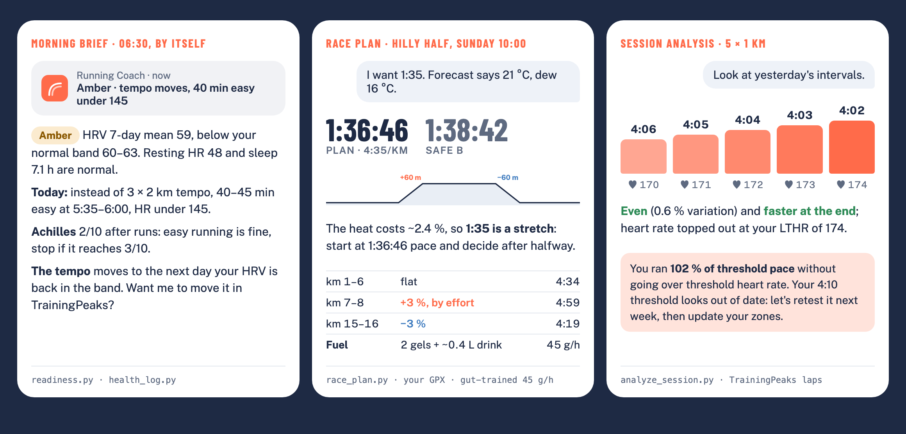

<p align="center">
  <picture>
    <source media="(prefers-color-scheme: dark)" srcset="assets/logo-wordmark-dark.svg">
    
  </picture>
</p>

<p align="center">
  <b>Running Coach for Claude</b>: a running coach that knows your history, tells you the truth, and puts the plan on your watch.<br>
  Season plans · weekly plans · HRV check-ins · session analysis · zones · race day<br>
  TrainingPeaks · Strava · or just a conversation
</p>

<p align="center">
  <a href="https://github.com/tomasstankovic/running-coach/actions/workflows/check.yml"></a>
  <a href="https://github.com/tomasstankovic/running-coach/releases/latest"></a>
  <a href="LICENSE"></a>
</p>

---

> **You:** I want a half marathon under 1:30 in April. I can run once a week.
>
> **Coach:** 1:30 means 4:16/km. Your recent 10k (48:30) points to about 1:47, so that's a 16 %
> jump, and one run a week won't get you there; 1:30 usually takes 5–6 runs and 55–75 km a week.
> Three honest options: aim for **1:42–1:45** this spring on 4 runs a week, keep 1:30 as a
> **next-season** goal, or tell me what time you could add. What sounds right?

Most "AI training plans" are a fresh guess every time. Running Coach works like a coach: it
learns who you are and what you've run, plans the season with you, checks in every day, reads
your sessions, and changes the plan when life happens. Paces, zones, load limits and predictions
come from scripts, not guesses, and it never touches your calendar without your yes.

<p align="center"></p>
<p align="center"><sub>The plugin's own script output for a fictional runner: morning brief · race plan · session analysis</sub></p>

### Try it in a minute

In Claude Code:

```bash
claude plugin install running-coach --marketplace tomasstankovic/running-coach
```

In Claude chat or Cowork, add the marketplace `tomasstankovic/running-coach` under *Customize →
Plugins* ([all options](#install)). Then just ask: *"Plan my week: 4 runs, a 10k in 8 weeks."*
No TrainingPeaks or Strava needed to start; connect them later for check-ins and analysis.

**Contents:** [Who it's for](#who-its-for) · [What it does](#what-it-does) ·
[A season with the coach](#a-season-with-the-coach) · [Install](#install) ·
[Connect your data](#connect-your-data) · [Privacy and safety](#privacy-and-safety) ·
[FAQ](#faq) · [The research behind it](#the-research-behind-it) · [What's inside](#whats-inside) ·
[Development](#development)

## Who it's for

**A good fit if you:**

- run 5 km to marathon (trail goals get the basics: time on feet, vertical, downhill), from a
  first 10k to a sub-3 marathon;
- coach yourself and want structure: a season plan, the right session today, and an honest
  answer to "is my goal realistic?";
- train with a watch and TrainingPeaks or Strava, and want the plan on the watch and the data
  actually read, not just collected;
- are coming back from a break, an injury or illness and want a sensible ramp, not a template;
- are a masters runner, have little time, or run on hills, and want the plan built around that.

**Not built for:**

- coaches managing several athletes (it coaches one runner: you);
- triathlon, cycling or ultra-specific periodization;
- medical or nutrition care: it's a coaching aid for healthy runners, and it sends you to a
  professional when pain, illness or red flags call for it.

It replies in your language (tested in English and Slovak).

## What it does

### Gets to know you

- **Onboarding, once.** Goals, the time you really have, which days suit you, units, terrain,
  injuries, and 12–24 months of your history: seasons, peaks, breaks, races, what worked.
- **Honest, not agreeable.** If the goal doesn't match your time or current level, it says so
  with numbers and offers real alternatives. Then you decide together.
- **Asks, doesn't impose.** Strength training (gym, home or bodyweight), threshold tests and how
  you like to train are discussed with you: why, the options, and what you prefer.
- **Remembers you.** Your profile (goals, weekly template, zones, injuries, decisions from past
  reviews) is kept as a TrainingPeaks note or a file, read at the start of every chat.

### Plans the season and the week

- **The whole season on one page.** A week-by-week plan to your A race (phases, volume, long
  run, key session), with B and C races built in, on a page with a fixed link that shows plan vs.
  actual, readiness, zones, forecasts and every change.
- **A map of the key sessions.** How threshold, tempo, VO2 and long runs progress through the
  season, designed around you (injuries, terrain, winter, what worked), with target paces from
  your threshold and goals and 6–10 milestones (threshold checks, the longest run, marathon-pace
  long runs, tune-up races). Each review marks what you ran against the target, and the next
  steps follow from it.
- **Weekly plans that pass a load check.** Volume jumps above ~10 %, a long run more than 10 %
  longer than your longest in the last month, back-to-back hard days, too much intensity and
  missing deload weeks are flagged before you see the plan.
- **Re-plans when life happens.** Illness, a work deadline, a missed week or "this week I'm in
  the mountains" reshape the rest by clear rules, and each change is logged.
- **Lands where you train.** With TrainingPeaks it writes structured runs and strength sessions
  to your calendar (after you confirm), so they sync to your watch. Without it, you get an `.ics`
  file for Google, Apple or Outlook calendar.

### Checks in every day

- **Morning check-in.** Today's HRV, resting heart rate and sleep against your own baseline:
  green, amber or red, and what that means for today's session.
- **Morning brief to your phone.** On a schedule: one line on the phone and a short check-in in
  the app (verdict, today's session with paces and heart-rate cap, niggles, the weather).
- **Pain and illness diary in TrainingPeaks.** Each report is a note in your TP calendar on the
  day it happened, so TP is the one record a physio or coach can see too. The coach reads it back
  and applies clear rules: easy running is fine, cut the quality, or stop and get it checked.

### Reads what you ran

- **Sessions like a coach.** Rep-by-rep evenness and fade, heart rate vs. threshold, recoveries;
  aerobic decoupling and efficiency on steady runs.
- **Durability.** How much efficiency you lose in the last quarter of long runs: what decides the
  last 10 km of a marathon, tracked over the season.
- **Weekly review**, on a schedule if you like (Sunday evening): what you ran vs. the plan, the
  key sessions, readiness, and next week.
- **Block reports.** At the end of each phase: volume, key sessions, durability, threshold,
  forecast, readiness and health, and what the next block changes.

### Zones and predictions

- **Training zones that keep up with you.** Your own zones (as in TrainingPeaks and on your
  watch, whatever the method: 80/20, Friel, 5-zone) in one table of pace, heart rate and power,
  in chat and on the plan page, with how your threshold moved. Other methods (% max HR,
  heart-rate reserve, Daniels VDOT) to compare, and a personal easy-run cap from your own long
  runs. Checked monthly and after races or tests; changes are proposed with what they mean for
  your paces, and written to TrainingPeaks only after your yes.
- **What you could run.** Current form over 5 km, 10 km, half and marathon, and a forecast for
  each of your races from recent results, threshold, weekly volume and your own history, adjusted
  for course and heat. Ranges, not wishful single numbers. With TrainingPeaks it also projects
  race day "if the plan happens", and tells you when a goal drifts out of reach.

### Race day

- **A plan for the real course and the real day.** The target from your forecast, moved for the
  weather (the real forecast in race week, the typical weather for that date before), splits by
  the course profile from its GPX, an A and a safe B goal.
- **Fuelling that adds up.** Carbs per hour capped at what your stomach handled in training, gel
  times matched to the aid stations plus the rest from sports drink, drinking to thirst, carb
  loading and breakfast in grams for your weight.
- **Gut training** on the long runs before it: 30 → 90 g/h step by step, each run logged.

### How it stays honest

- **Computed, not guessed.** Paces, zones, load checks, readiness, predictions and splits come
  from scripts, so they're the same every week.
- **Grounded in research.** Load limits from a 5,200-runner injury study, HRV-guided training,
  evidence-based tapers, strength, fuelling and heat guidance; each rule carries its source and
  how strong the evidence is ([the research behind it](#the-research-behind-it)).
- **Tested.** Behaviour tests for every script, and 39 eval cases of real coaching conversations
  in English and Slovak, run against Claude with and without the skill
  ([results](#with-and-without-the-plugin)).

### With and without the plugin

The same question asked of Claude without the plugin and with it, in English and in Slovak (the
same runner, data and checks, translated), scored against what a coach would expect. Run with
`claude plugin eval` on 5 November 2026 (version 0.16.0), fictional runners, 2 runs per case in
each arm; each cell is *without → with*.

| Question | English | Slovak | What plain Claude missed |
|---|---:|---:|---|
| Race plan for a hilly half at 21 °C, goal 1:35 | 25 → 88 % | 12 → 100 % | the goal moved for the heat, fuelling that adds up to 45 g/h, carb loading |
| "My base block is over, how did it go?" | 50 → 88 % | 62 → 88 % | how many key sessions were on target, missed or under; what to do about the missed steps |
| Morning brief on a low-HRV day | 80 → 90 % | 60 → 100 % | the one-line phone notification; sometimes the swap of the tempo for an easy run |
| Calf pain up from 2/10 to 5/10 in ten days | 83 → 100 % | 67 → 83 % | asking before writing to the TrainingPeaks diary |
| "My stomach turns on gels in races" | 50 → 75 % | 62 → 100 % | glucose + fructose above 60 g/h; a log after each long run that becomes the race-day rate |
| "Hard at the end" of a 26 km long run | 83 → 100 % | 67 → 100 % | the ~9 % fade in the last quarter, linked to the wall at km 32 |

Faster runners (tag `performance`; the skill was improved twice on these cases before this run):

| Question | English | Slovak | What plain Claude missed |
|---|---:|---:|---|
| Sub-2:45 marathon from 2:51 and a 1:20 half, "should I do double threshold?" | 75 → 100 % | – | volume steps; long marathon-pace segments and a tune-up race |
| Sub-3 marathon from 3:08 at 60 km a week | 100 → 100 % | 100 → 88 % | nothing: plain Claude does this one well too |
| Sub-1:20 half from 1:22:30 and a 17:05 5k | 100 → 100 % | – | nothing: plain Claude does this one well too |
| Sub-1:30 half on 5 hours a week | 67 → 100 % | 100 → 100 % | in English, two quality sessions moving to half-marathon-pace blocks |

On the eight questions asked in both languages, plain Claude scored 67 % in English and 66 % in
Slovak, and Claude with the plugin 93 % and 95 %. The block review row is from a re-run after a
fix to the skill (the coach now runs the block report instead of counting by hand). A small set:
one judge's vote moves a case by 10–25 points, so read it as a direction, not a benchmark. Run it
yourself: [Development](#development).

<p align="center"></p>

More in **[examples](docs/examples.md)**: a week stopped by the load check, an interval session
read rep by rep, a morning check-in, a marathon prediction. What changed when:
**[changelog](CHANGELOG.md)**.

## The research behind it

Every rule in the skill carries its source and how strong the evidence is: **strong**
(meta-analyses, large cohorts, consistent trials), **moderate** (smaller or mixed studies,
consensus statements) or **practice** (coaching convention without direct trials). Where the
evidence for amateurs is missing, for example Norwegian-singles sub-threshold weeks, training to
a runner's "type", or the ideal share of the long run, the coach says so instead of selling it as
science. The studies that matter most:

| Topic | What the coach does with it | Behind it |
|---|---|---|
| Load and injury | no single run more than 10 % longer than the longest of the last 30 days; the weekly 10 % rule isn't the limit | 5,205 runners, 588,071 runs (Frandsen et al. 2025); RCT of a 10 % plan, 532 novices (Buist et al.) |
| Intensity | a pyramidal week by default; a threshold-leaning mix gave the same gains in 17 % less time | network meta-analysis, 348 athletes (Rosenblat et al. 2025); RCT in recreational runners (Festa et al. 2020) |
| Volume | about 4 min off a marathon per extra 10 km a week; faster marathoners mostly run more easy | 151,813 marathons (Muniz-Pumares et al. 2025); 2,303 runners (Vickers & Vertosick 2016); Tanda 2011 |
| Readiness | train by your own HRV band, not by a fixed plan | RCT: 10 km +6.2 % vs +2.9 % on a fixed plan (Nuuttila et al. 2022) |
| Busy weeks | 2 runs a week with some intensity, never easy-only | review of the minimal dose (Spiering et al. 2021); runner trials (Houmard 1990, McConell 1993) |
| Taper | ~2 weeks, −41–60 % volume, intensity kept | meta-analysis (Bosquet et al. 2007); 158,117 marathoners (Smyth & Lawlor 2021) |
| Durability and pacing | late-race fade read from heart-rate drift; even pacing | 82,303 marathoners (Smyth et al. 2022); ~1.7 million results: 28 % of men hit the wall (Smyth 2018, 2021) |
| Strength | heavy lifting + plyometrics, 2 × 20–30 min a week | meta-analyses: running economy 2–8 % better (Blagrove et al. 2018; Llanos-Lagos et al. 2024) |
| Predictions | Riegel's formula corrected by weekly volume for the marathon | Vickers & Vertosick 2016; Tanda 2011 |
| Fuelling and heat | 30–90 g of carbohydrate an hour by duration; slower goals in the heat | ACSM position stand (Thomas et al. 2016); Ely et al. 2007 |
| Pain | easy running with pain up to ~3/10 that settles by the next morning | RCT, Achilles tendinopathy (Silbernagel et al. 2007) |

All 63 sources, with DOIs and the rule each one supports:
**[sources.md](skills/running-coach/references/sources.md)**. Nothing here replaces a doctor or a
physio; the coach refers you when the signs call for it.

## A season with the coach

Just talk to it like a coach. There's no command to type: the skill loads by itself whenever you
ask about your running, in any language ("Mám dnes behať?" works as well as "Should I run
today?"). You can also call it as `/running-coach`.

**1. Onboarding (once, ~15 min).** "Let's start. Go through my training history and ask what you
need." It studies the last 1–2 years, asks about your goals, days, units, terrain and health,
checks whether the goals fit your time and form, and saves your profile after you agree.

**2. Season plan (once per season).** "Plan my season up to the marathon on 2 May; the half on
3 April is a B race." You get the weeks, the key-session map, your zones and the first race
forecasts on the plan page; races go to your calendar.

**3. The weekly rhythm.** Start a new chat for each topic; the coach reads your profile every
time, so nothing has to be repeated.

| When | Ask |
|---|---|
| morning, before a run | "Should I run today?" · "Slept 5 hours, intervals are planned. Should I go?" |
| after a key session | "Look at today's intervals." · "How was my long run?" |
| end of the week | "How did the week go? Plan the next one." |
| end of a phase | "The base block is done. How did it go?" |
| any time | "Show me the season plan." · "Which key sessions are coming up?" |
| predictions | "What could I run a half marathon in now?" · "Is 3:15 realistic for my marathon?" |
| training zones | "Show me my training zones." · "I ran a half on Sunday: should my zones change?" |
| life happens | "I've had a fever since Tuesday." · "Work is crazy for two weeks." · "I'm in the mountains until Sunday." |
| pain | "My left calf hurts, 3/10 during runs." · "It's worse than last time." |
| strength | "Add two strength sessions a week, I have a kettlebell at home." |
| fuelling | "How do I train my stomach for gels before the marathon?" |
| race week | "Race plan for Sunday's half: pacing and what to eat." · "Plan for Prague with this GPX." |

**4. Let it run by itself (optional, Claude desktop app).** After the first check-in and the
first review, the coach offers to schedule the morning brief (e.g. 06:30 every day) and the
weekly review (Sunday evening). They run while the app is open; the brief reaches your phone
when Remote Control is connected. Nothing is changed in TrainingPeaks by a scheduled run: if a
session should move, it says so and waits for you.

**Where it remembers you.** With TrainingPeaks, your profile is a note in your TrainingPeaks
calendar called `Running coach profile`; you can read and edit it. The season plan lives on its
page with a fixed link or, in chat, in a second note called `Running coach plan`. In a folder
session without TrainingPeaks, both are files in `running-coach/` in your folder; in chat without
TrainingPeaks, files you add to your Claude Project (see [Choose your setup](#choose-your-setup)).

**Tip.** In a Claude Project, put this in the project instructions so the skill always loads first:

```
For every question about my running (training, plans, races, predictions, HRV and recovery,
illness, strength, TrainingPeaks data), load the running-coach skill first and follow it, even if
I don't name it. Never write, change or delete anything in TrainingPeaks without my explicit yes.
```

## Install

**Claude chat and Cowork (web, desktop):** open *Customize → Plugins*, click *Add → Add
marketplace → Add from a repository*, enter `tomasstankovic/running-coach`, then add the
*Running Coach* plugin. New versions come from this repository; if one doesn't show up, use
*Update* on the marketplace.

**claude.ai without plugins:** download `running-coach.zip` from the
[latest release](https://github.com/tomasstankovic/running-coach/releases/latest), enable *Code
execution* in *Settings → Capabilities*, and upload the zip under *Skills*. Upload the new zip
again for each new version.

**Claude Code:** at the prompt of a terminal session:

```
/plugin install running-coach --marketplace tomasstankovic/running-coach
```

From a shell:

```bash
claude plugin install running-coach --marketplace tomasstankovic/running-coach
```

In the Claude desktop app (Code tab): click **+** next to the prompt box, then *Plugins → Add
marketplace* with `tomasstankovic/running-coach`, then *Add plugin*.

## Connect your data

Optional, but recommended.

| Source | Where it works | What you get |
|---|---|---|
| [trainingpeaks-mcp](https://github.com/JamsusMaximus/trainingpeaks-mcp) | Claude Desktop, Claude Code (runs locally) | full mode: reads zones, HRV, sleep, CTL/ATL/TSB, planned and completed workouts, notes; writes structured workouts, zones and diary notes after you confirm |
| Strava connector (*Settings → Connectors → Strava*) | web, desktop, mobile | reads completed activities and HR zones; plan delivered as text + `.ics` |
| nothing | everywhere | asks a few questions (recent race, weekly volume, goal), plan as text + `.ics` |

A note on trainingpeaks-mcp: it's a community project that uses your TrainingPeaks session cookie,
which gives full access to your account. Pin a version you've looked at, and keep it local.

### Choose your setup

Where you talk to the coach decides what it can read, what it can write, and where it remembers
you between chats. Claude itself starts every chat fresh; the coach keeps your profile and plan
in one of these places.

| Setup | Good | Missing | Where it remembers you |
|---|---|---|---|
| **TrainingPeaks + Claude desktop app, a session with a folder** (Code or Cowork) — *best results* | everything: HRV, sleep, CTL/TSB and workouts in; structured workouts out to your calendar and watch; the season page with a fixed link; weekly review and morning brief on a schedule; files saved for you | desktop only (Mac/Windows); scheduled runs need the app open; trainingpeaks-mcp runs locally | profile as a TP note, plan on its page + in the folder |
| **TrainingPeaks + a Claude Project in desktop chat** | full data in and out, structured workouts on your watch | no fixed-link page or schedules; the full plan file is yours to add to the Project; not on your phone (the TP connection is local) | profile and plan as TP notes |
| **Strava** (web, desktop, mobile) | works everywhere, also on the phone; reads your runs and heart rate | read-only: sessions come as text + a calendar file; no HRV or sleep, so readiness relies on how you feel; no TSS/CTL | in a folder session: files there; in chat: files you add to the Project |
| **No data** | works anywhere, no setup | it asks for what it can't read; analysis stays rough | as with Strava |

**For the best results:** TrainingPeaks with the Claude desktop app, in its own session with a
folder (e.g. `~/Documents/Running`). Keep a Claude Project in chat for quick questions on the go.
In your first conversation the coach explains what your setup gives you and lets you choose.

## Privacy and safety

- **Nothing changes without your yes.** The coach never writes, changes or deletes anything in
  TrainingPeaks (workouts, zones, notes, events) without your explicit agreement, and scheduled
  runs only suggest.
- **The skill collects nothing.** Its scripts run locally (Python standard library only) on the
  data Claude passes them. Your training data reaches Claude only through the connectors you
  choose.
- **One network call: the weather.** `weather.py` asks [Open-Meteo](https://open-meteo.com) for
  the forecast or the typical weather at a race venue or your town's coordinates. It never sends
  a home address or any training data.
- **Not medical advice.** Pain that changes your stride, pain at rest, chest pain, fainting or an
  unusual heart-rate response: stop and see a professional. Signs of low energy availability are
  referred, not coached.

## FAQ

**Do I need TrainingPeaks?** No. It works with Strava or with no data at all; TrainingPeaks adds
HRV and sleep for readiness, CTL/TSB, and structured workouts on your watch.

**Does it work with my Garmin, COROS or Suunto?** Through TrainingPeaks: structured workouts the
coach writes to your TP calendar sync to the watches TrainingPeaks supports, and your runs come
back the same way. There's no direct watch connection.

**Will it change my plan or calendar on its own?** No. It proposes, shows what changes and why,
and writes only after you say yes.

**Can it coach a beginner?** Yes: a first 5k or 10k plan starts from what you can run now, mostly
easy running on three days a week, with a slower ramp and stricter load checks. The same
cautious mode applies after an injury in the last 12 months.

**What if I miss a week or get sick?** Tell it. Illness follows clear return-to-run rules (fever
or chest symptoms: no running, then a short test run), and the season plan is re-planned from
what you actually ran.

**Is it a replacement for a human coach?** It does the planning, checking and number work a
coach does, and it's honest about goals. It can't watch you run, and it doesn't replace a physio
or doctor.

**How do I get new versions?** Plugins update when a new version is published here; the
claude.ai ZIP needs to be uploaded again. In the first conversation after an update the coach
says what it has learned that matters for you, checks your plan against the new rules (it
proposes changes and makes them only after your yes) and refreshes your plan page. See the [changelog](CHANGELOG.md).

## What's inside

```
skills/running-coach/
├── SKILL.md                    modes and the core workflow
├── assets/
│   └── season-plan.html        the season plan page (published once, then updated in place)
├── evals/                      39 eval cases (claude plugin eval) on fictional runners, en + sk
├── references/
│   ├── onboarding.md           questionnaire, history assessment, athlete profile
│   ├── week.md                 planning a week: role, draft, load check, format, saving
│   ├── season.md               season plan, races A/B/C, key sessions, re-planning, plan page, weekly review
│   ├── methodology.md          intensity, zones, progression, periodization, thresholds, illness, age, health
│   ├── analysis.md             reading a session: reps, decoupling, durability, race predictions
│   ├── sources.md              the research behind each rule, with evidence strength
│   ├── workouts.md             session library with TrainingPeaks structures, fuelling practice
│   ├── strength.md             strength for runners: placement, phases, TP strength workouts
│   ├── checkin-and-race.md     daily check-in, morning brief, pain and illness diary, race plan
│   ├── trainingpeaks.md        TP tools, structure format, zones, pitfalls
│   └── strava.md               Strava tools and how to fill what Strava lacks
└── scripts/
    ├── paces.py                zones, pace ↔ % threshold, threshold from a race, predictions
    │                           (incl. volume-aware marathon models), splits
    ├── check_week.py           load-progression checks (TP, Strava, or weekly totals)
    ├── readiness.py            HRV 7-day trend / resting HR / sleep vs. personal baseline
    ├── analyze_session.py      one session from TrainingPeaks → reps, drift, efficiency, durability
    ├── forecast.py             current form over 5k–marathon + race-day forecast per race
    ├── zones.py                training zones (pace, HR, power) and proposals to update them
    ├── race_plan.py            race plan: target with weather, splits by course, fuelling
    ├── weather.py              forecast or typical weather for a run or race (Open-Meteo)
    ├── health_log.py           pain and illness diary as TrainingPeaks notes
    ├── block_report.py         what a training block brought
    ├── history_summary.py      1–2 years → seasons, peaks, breaks, likely races, best efforts
    ├── season_plan.py          rough season plan, re-planning, actuals, export to the plan page
    ├── key_sessions.py         key-session roadmap: progressions, milestones, targets, verdicts
    ├── page_docs.py            any list of rows → plan page database writes
    ├── terrain.py              elevation gain per km → flat / rolling / hilly / mountain
    ├── tp_structure.py         session → TrainingPeaks structure in km or time
    └── export_ics.py           plan → calendar file
```

## Development

Run `python3 tests/check_skill.py` and `python3 -m unittest discover -s tests` (CI runs both on
every push: description length and YAML, referenced files, source tags, version, and behaviour
tests of every script on fictional data).

For coaching behaviour, run the eval cases from `skills/running-coach`. They are real, billed
model runs; by default each case also runs once without the skill, so the report shows what the
skill adds. `--tag v015` or `--case <name>` runs a subset; `--tag en` or `--tag sk` one
language, and `--tag readme` the cases behind the tables above, in both languages:

```bash
claude plugin eval . --scaffold --allow-tools Bash Write Edit --runs 1
```

The English `en-*` copies of the Slovak README cases are generated: after changing one of those
Slovak cases, run `python3 tests/make_en_evals.py` so both languages stay the same test.

Cases whose graders rely on numbers from a script (block volume and key-session counts, the pain
trend, the readiness verdict, the longest allowed run) keep those numbers in `expected.json`
beside their `files/`. `tests/test_eval_fixtures.py` runs the script on the case's files and
checks them, so a changed script or fixture fails in CI instead of quietly making the graders
wrong. The model under test never sees the file.

**Releasing:** add an entry to `CHANGELOG.md` and bump `version` in `.claude-plugin/plugin.json`
(semver) with every change you want users to receive; installed copies update only when the
version changes. Push to `main`, tag the version, and attach `running-coach.zip` (the skill
folder without `evals/`) to the GitHub release.

## License

MIT
