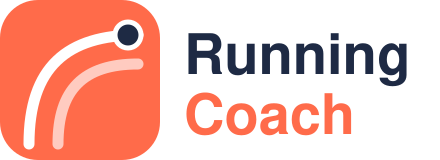
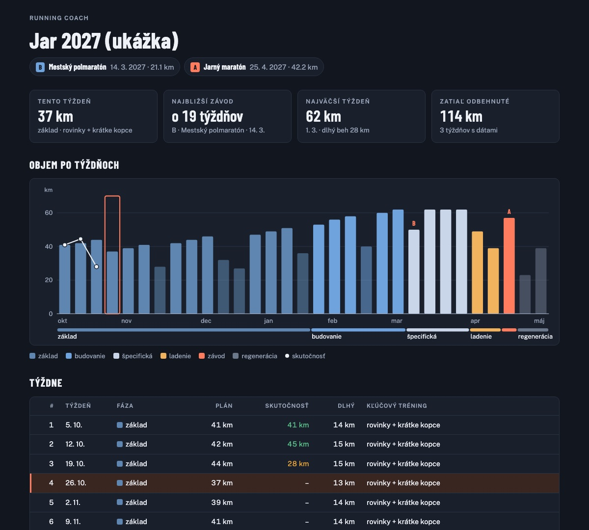

<p align="center">
  <picture>
    <source media="(prefers-color-scheme: dark)" srcset="assets/logo-wordmark-dark.svg">
    
  </picture>
</p>

<p align="center">
  <b>Running Coach for Claude</b>: a running coach that knows your history, tells you the truth, and puts the plan on your watch.<br>
  Season plans · weekly plans · HRV check-ins · session analysis · strength · race day<br>
  TrainingPeaks · Strava · or just a conversation
</p>

<p align="center">
  <a href="https://github.com/tomasstankovic/running-coach/actions/workflows/check.yml"></a>
  <a href="https://github.com/tomasstankovic/running-coach/releases/latest"></a>
  <a href="LICENSE"></a>
</p>

---

> **You:** I want a half marathon under 1:30 in April. I can run once a week.
>
> **Coach:** 1:30 means 4:16/km. Your recent 10k (48:30) points to about 1:47, so that's a 16 %
> jump, and one run a week won't get you there; 1:30 usually takes 5–6 runs and 55–75 km a week.
> Three honest options: aim for **1:42–1:45** this spring on 4 runs a week, keep 1:30 as a
> **next-season** goal, or tell me what time you could add. What sounds right?

Most "AI training plans" are a fresh guess every time. This one works like a coach:

- **Gets to know you first.** Goals, the time you really have, which days suit you, injuries,
  and 12–24 months of your history: seasons, peaks, breaks, races, what worked.
- **Honest, not agreeable.** If the goal doesn't match your time or current level, it says so
  with numbers and offers real alternatives. Then you decide together.
- **Asks, doesn't impose.** Strength training (gym, home or bodyweight) and threshold tests are
  discussed with you: why, what the options are, and what you prefer.
- **The whole season on one page.** A rough week-by-week plan to your A race (phases, volume,
  long run, key session), with B and C races built in. It lives on a page with a fixed link that
  shows plan vs. actual and every change. Illness, a work deadline or a missed week re-plans the
  rest by clear rules, and the weekly review can run by itself every Sunday.
- **Training zones that keep up with you.** Your own zones (as in TrainingPeaks and on your
  watch, whatever the method: 80/20, Friel, 5-zone) in one table of pace, heart rate and power,
  in chat and on the plan page, with how your threshold moved. Other methods (% max HR, heart-rate
  reserve, Daniels VDOT) to compare, and a personal easy-run cap from your own long runs' drift.
  Checked every month and after races or tests; a change is proposed with what it means for your
  paces, and written to TrainingPeaks only after your yes.
- **Race plans for the real course and the real day.** The target from your forecast, moved for
  the weather (the real forecast in race week, the typical weather of that date before), splits by
  the course profile from its GPX, and the fuelling plan with gel times at the aid stations, capped
  at what your stomach handled in training.
- **Durability.** How much efficiency you lose in the last quarter of long runs: the thing that
  decides the last 10 km of a marathon, tracked over the season.
- **Pain and illness diary in TrainingPeaks.** Each report is a note in your TP calendar, so TP
  is the one record; the coach reads it back in every check-in and review and tells you what it
  means for training.
- **Morning brief to your phone.** One line every morning: readiness, today's session with its
  paces, active niggles, the weather.
- **Block reports.** At the end of each phase: volume, key sessions, durability, threshold,
  forecast, readiness and health, and what the next block changes.
- **A map of the key sessions.** How threshold, tempo, VO2 and long runs progress through the
  season, designed around you (injuries, terrain, what worked for you, winter), with target paces
  computed from your threshold and goals, and 6–10 milestones (the threshold check, the longest
  run, marathon-pace long runs, tune-up races). A script checks the rules (recovery after races,
  no two hard days in a row). Each review compares what you ran with the target (on target,
  better, under, missed), and the next steps follow from it.
- **Your units, your ground.** Kilometres or minutes, as you prefer. It reads how hilly your runs
  are, asks where you can run fast, and steers by pace on the flat and by heart rate on hills.
  "This week I'm in the mountains" reshapes the rest of the week.
- **Grounded in research.** Load limits from a 5,200-runner injury study (no single run more
  than 10 % longer than your longest in the last month), HRV-guided readiness, evidence-based
  tapers, strength, fuelling and heat guidance, each rule tagged with its source and how strong
  the evidence is.
- **Reads your sessions like a coach.** Rep-by-rep evenness and fade, heart rate vs. threshold,
  aerobic decoupling and efficiency on long runs, and marathon predictions that account for your
  weekly volume.
- **Knows what you could run.** Current form over 5 km, 10 km, half and marathon, and a forecast
  for each of your races, from your recent races, threshold, weekly volume, your plan and your own
  past results, adjusted for course and heat. Ranges, not wishful single numbers. With
  TrainingPeaks it also projects race day "if the plan happens", from your own results against
  your CTL. The plan page shows how each forecast moves week by week, and it tells you when a goal
  drifts out of reach.
- **Computed, not guessed.** Paces, heart-rate zones, race predictions and splits come from
  scripts, so they're the same every week.
- **Checked before you see it.** A load checker flags volume jumps above ~10 %, back-to-back hard
  days, an oversized long run, too much intensity and missing deload weeks.
- **Remembers you.** Your profile (goals, weekly template, injuries, decisions from past reviews)
  is saved as a TrainingPeaks note or a file in your Claude Project.
- **Morning check-in.** Compares today's HRV, resting HR and sleep with your own baseline (green,
  amber or red) and adjusts today's session.
- **Lands where you train.** With TrainingPeaks it writes structured workouts and strength sessions
  to your calendar (after you confirm), so they sync to your watch. Without it, you get an `.ics`
  file for Google/Apple/Outlook calendar.

It replies in your language (tested in English and Slovak).

<p align="center"></p>

More in **[examples](docs/examples.md)**: a week stopped by the load check, an interval session
read rep by rep, a morning check-in, a marathon prediction. What changed when:
**[changelog](CHANGELOG.md)**.

## Install

**Claude chat and Cowork (web, desktop):** open *Customize → Plugins*, click *Add → Add
marketplace → Add from a repository*, enter `tomasstankovic/running-coach`, then add the
*Running Coach* plugin. New versions come from this repository; if one doesn't show up, use
*Update* on the marketplace.

**claude.ai without plugins:** download `running-coach.zip` from the
[latest release](https://github.com/tomasstankovic/running-coach/releases/latest), enable *Code
execution* in *Settings → Capabilities*, and upload the zip under *Skills*. Upload the new zip
again for each new version.

**Claude Code:** at the prompt of a terminal session:

```
/plugin install running-coach --marketplace tomasstankovic/running-coach
```

From a shell:

```bash
claude plugin install running-coach --marketplace tomasstankovic/running-coach
```

In the Claude desktop app (Code tab): click **+** next to the prompt box, then *Plugins → Add
marketplace* with `tomasstankovic/running-coach`, then *Add plugin*.

## Connect your data (optional, but recommended)

| Source | Where it works | What you get |
|---|---|---|
| [trainingpeaks-mcp](https://github.com/JamsusMaximus/trainingpeaks-mcp) | Claude Desktop, Claude Code (runs locally) | full mode: reads zones, CTL/ATL/TSB, planned + completed workouts; writes structured workouts to your calendar |
| Strava connector (*Settings → Connectors → Strava*) | web, desktop, mobile | reads completed activities and HR zones; plan delivered as text + `.ics` |
| nothing | everywhere | asks a few questions (recent race, weekly volume, goal), plan as text + `.ics` |

A note on trainingpeaks-mcp: it's a community project that uses your TrainingPeaks session cookie,
which gives full access to your account. Pin a version you've looked at, and keep it local. The
skill never writes, changes or deletes anything in TrainingPeaks without your explicit yes.

**Privacy.** The skill itself collects nothing and sends nothing anywhere. Its scripts run
locally (Python standard library only), make no network calls, and work only on the data
Claude passes them. Your training data reaches Claude only through the connectors you choose to
connect.

## Choose your setup

Where you talk to the coach decides what it can read, what it can write, and where it remembers
you between chats. Claude itself starts every chat fresh; the coach keeps your profile and plan
in one of these places.

| Setup | Good | Missing | Where it remembers you |
|---|---|---|---|
| **TrainingPeaks + Claude desktop app, a session with a folder** (Code or Cowork) — *best results* | everything: HRV, sleep, CTL/TSB and workouts in; structured workouts out to your calendar and watch; the season page with a fixed link; weekly review and morning check-in on a schedule; files saved for you | desktop only (Mac/Windows); scheduled runs need the app open; trainingpeaks-mcp runs locally | profile as a TP note, plan on its page + in the folder |
| **TrainingPeaks + a Claude Project in desktop chat** | full data in and out, structured workouts on your watch | no fixed-link page or schedules; the full plan file is yours to add to the Project; not on your phone (the TP connection is local) | profile and plan as TP notes |
| **Strava** (web, desktop, mobile) | works everywhere, also on the phone; reads your runs and heart rate | read-only: sessions come as text + a calendar file; no HRV or sleep, so readiness relies on how you feel; no TSS/CTL | in a folder session: files there; in chat: files you add to the Project |
| **No data** | works anywhere, no setup | it asks for what it can't read; analysis stays rough | as with Strava |

**For the best results:** TrainingPeaks with the Claude desktop app, in its own session with a
folder (e.g. `~/Documents/Running`). Keep a Claude Project in chat for quick questions on the go.
In your first conversation the coach explains what your setup gives you and lets you choose.

## How to use it

Just talk to it like a coach. There's no command to type: the skill loads by itself whenever you
ask about your running, in any language ("Mám dnes behať?" works as well as "Should I run
today?").

**Getting started**

1. **Onboarding (once, ~15 min).** "Let's start. Go through my training history and ask what you
   need." It studies the last 1–2 years, asks about your goals, days, units, terrain and health,
   checks whether the goals fit your time and form, and saves your profile after you agree.
2. **Season plan (once per season).** "Plan my season up to the marathon on 2 May; the half on
   3 April is a B race." Races go to your calendar, the weeks to the plan, and you get the first
   race predictions.
3. **Then the weekly rhythm** below. Start a new chat for each topic: the coach reads your
   profile at the start of every chat, so nothing has to be repeated.

**What to ask**

| When | Ask |
|---|---|
| morning, before a run | "Should I run today?" · "Slept 5 hours, intervals are planned. Should I go?" |
| after a key session | "Look at today's intervals." · "How was my long run?" |
| end of the week | "How did the week go? Plan the next one." |
| any time | "Show me the season plan." · "Which key sessions are coming up?" |
| predictions | "What could I run a half marathon in now?" · "Is 3:15 realistic for my marathon?" |
| life happens | "I've had a fever since Tuesday." · "Work is crazy for two weeks." · "I'm in the mountains until Sunday." |
| strength | "Add two strength sessions a week, I have a kettlebell at home." |
| race week | "Race plan for Sunday's half: pacing and what to eat." · "Plan for Prague with this GPX." |
| pain, illness | "My left calf hurts, 3/10 during runs." · "I've got a cold, no fever." |
| training zones | "Show me my training zones." · "I ran a half on Sunday: should my zones change?" · "When should I retest my threshold?" |

**Where it remembers you.** With TrainingPeaks, your profile (goals, availability, zones,
injuries, decisions from past reviews) is a note in your TrainingPeaks calendar called
`Running coach profile`; you can read and edit it. The season plan lives on its page with a fixed
link or, in chat, in a second note called `Running coach plan`. In a folder session without
TrainingPeaks, both are files in `running-coach/` in your folder; in chat without TrainingPeaks,
files you add to your Claude Project (see "Choose your setup").

**Tip.** In a Claude Project, put this in the project instructions so the skill always loads first:

```
For every question about my running (training, plans, races, predictions, HRV and recovery,
illness, strength, TrainingPeaks data), load the running-coach skill first and follow it, even if
I don't name it. Never write, change or delete anything in TrainingPeaks without my explicit yes.
```

## What's inside

```
skills/running-coach/
├── SKILL.md                    modes and the core workflow
├── assets/
│   └── season-plan.html        the season plan page (published once, then updated in place)
├── evals/                      8 test cases (claude plugin eval): load rules, check-ins, pushback
├── references/
│   ├── onboarding.md           questionnaire, history assessment, athlete profile
│   ├── season.md               season plan, races A/B/C, re-planning rules, plan page, weekly review
│   ├── methodology.md          intensity, progression, periodization, thresholds, illness, age, health
│   ├── analysis.md             reading a session: reps, decoupling, efficiency, race predictions
│   ├── sources.md              the research behind each rule, with evidence strength
│   ├── workouts.md             session library with TrainingPeaks structures
│   ├── strength.md             strength for runners: placement, phases, TP strength workouts
│   ├── checkin-and-race.md     daily readiness check-in, race pacing and fuelling
│   ├── trainingpeaks.md        TP tools, structure format, pitfalls
│   └── strava.md               Strava tools and how to fill what Strava lacks
└── scripts/
    ├── paces.py                zones, pace ↔ % threshold, threshold from a race, predictions
    │                           (incl. volume-aware marathon models), splits
    ├── check_week.py           load-progression checks (TP, Strava, or weekly totals)
    ├── readiness.py            HRV 7-day trend / resting HR / sleep vs. personal baseline
    ├── analyze_session.py      one session from TrainingPeaks → reps, drift, efficiency
    ├── forecast.py             current form over 5k–marathon + race-day forecast per race
    ├── zones.py                training zones (pace, HR, power) and proposals to update them
    ├── race_plan.py            race plan: target with weather, splits by course, fuelling
    ├── weather.py              forecast or typical weather for a run or race (Open-Meteo)
    ├── health_log.py           pain and illness diary as TrainingPeaks notes
    ├── block_report.py         what a training block brought
    ├── history_summary.py      1–2 years → seasons, peaks, breaks, likely races, best efforts
    ├── season_plan.py          rough season plan, re-planning, actuals, export to the plan page
    ├── key_sessions.py         key-session roadmap: progressions, milestones, targets, verdicts
    ├── page_docs.py            any list of rows → plan page database writes
    ├── terrain.py              elevation gain per km → flat / rolling / hilly / mountain
    ├── tp_structure.py         session → TrainingPeaks structure in km or time
    └── export_ics.py           plan → calendar file
```

## Releasing a new version

Run `python3 tests/check_skill.py` and `python3 -m unittest discover -s tests` (CI runs both on
every push: description length and YAML, referenced files, source tags, version, and behaviour
tests of every script on fictional data). For coaching behaviour, run the eval cases from
`skills/running-coach` (real, billed model runs):

```bash
claude plugin eval . --scaffold --allow-tools Bash Write Edit --runs 1
```

Add an entry to `CHANGELOG.md`. The release ZIP leaves `evals/` out. Bump `version` in `.claude-plugin/plugin.json` (semver)
with every change you want users to receive; installed copies update only when the version
changes. Then push to `main`.

## Disclaimer

This is a coaching aid for healthy recreational runners, not medical advice. Pain that changes
your stride, chest pain, dizziness or unusual heart-rate responses: stop and see a professional.

## License

MIT
