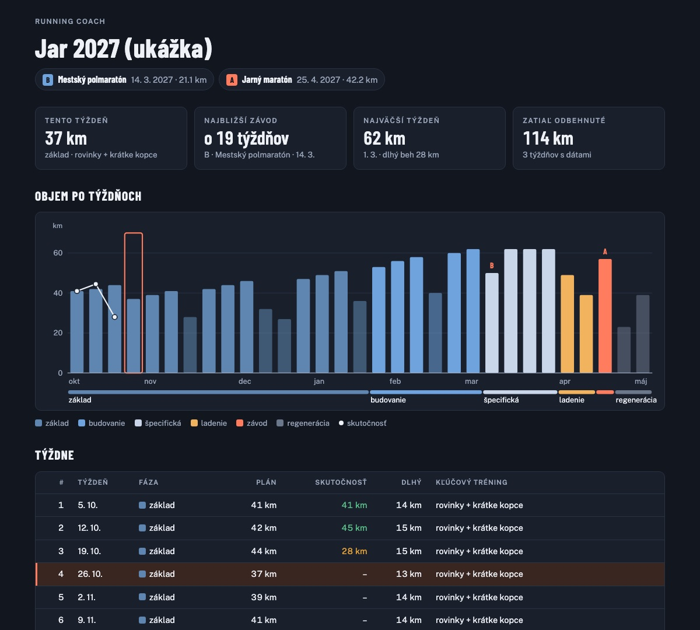

# Examples

What the coach's scripts print and what the coach makes of it. The runner is fictional: a
5-run-a-week half-marathoner with a 4:10/km threshold and LTHR 174. The coach always answers in
the runner's language; the scripts print English.



*The season plan page: phases, planned volume and actual weeks, races, this week highlighted.*

## Checking a week before it's shown

The coach drafted a week with a 17 km long run. `check_week.py` stops it:

```
Longest allowed run (30-day longest + 10 %, before this week's runs): 16.5 km from 02.11
FAIL  volume +24 % (198 → 245 min); keep ≤ +15 % (hard limit +20 %)
WARN  3 weeks of rising load without a lighter week; consider making this a deload
FAIL  2026-11-08: 17 km is 13 % longer than the longest run of the last 30 days (15 km); keep every run within +10 %
OK    1 hard days (max 2 for a build week)
OK    ~9 % of time at X/Z3 or harder (target ≤ 20 %, warn > 25 %)
```

What the runner sees instead: a deload week (it's been three rising weeks), and next week's long
run at 16.5 km, not 17. The reason in one line: one run more than 10 % past the longest of the
last month raised injury risk by ~60 % in a 5,200-runner study.

## Reading an interval session

`analyze_session.py` on 5 × 1 km from TrainingPeaks:

```
Structured session: 5 reps in 1 kind(s)

Reps, kind 1: 5 x 1.00 km (~4:04)
rep   dist    time   pace    NGP  avgHR  maxHR  %thr
  1  1.00k    4:06   4:06   4:06    163    170   102
  ...
  5  1.00k    4:02   4:02   4:02    167    174   103
mean graded pace 4:04 = 102 % of threshold speed
OK pace variation 0.6 % (even)
OK first to last rep -1.6 %
OK HR at the end of reps vs LTHR 174: last rep max 174
NOTE reps faster than threshold pace without HR above LTHR: the threshold may be stale (raise a retest)
```

The coach's reading: even, controlled reps, slightly faster than prescribed with HR still at
threshold. Next week one more rep at the same pace, and a suggestion to discuss a threshold
retest, since the zones may be too slow.

## Morning check-in

`readiness.py` on 56 days of Garmin metrics, after a few bad nights:

```
2026-10-26: RED
  RED   HRV 7-day mean below the normal band for 4+ days: cut volume ~25 % for 3-4 days, no quality
  AMBER resting HR 7-day mean above baseline + 1 SD
  ·     HRV 38; 7-day mean 40 vs normal band 53-56 (49 baseline days)
```

The coach's answer: today 30 min very easy or rest, Thursday's intervals moved to next week, and
a question about sleep, stress and illness symptoms.

## Marathon prediction

A 10k in 48:30 on 40 km a week. Riegel says 3:43; the volume-aware model says otherwise:

```
Marathon with training volume:
  Vickers model 1  4:02:25  5:45/km  (race + 40 km/week)
```

The coach plans from ~4:00 and revisits after the half-marathon tune-up, instead of setting a
goal pace the training can't support.
